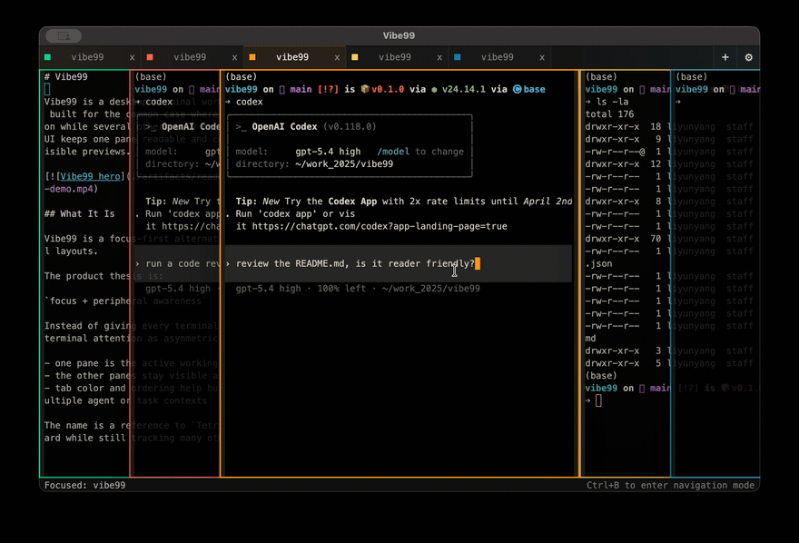

<p align="center"></p>
<p align="center"><a href="README_CN.md">中文</a> | <strong>English</strong></p>

# Vibe99

One developer now runs four or five coding agents at once. Traditional terminals give you two bad choices: tabs hide background agents until you forget they finished, while split grids shrink every pane until you cannot read any of them.

**Vibe99** is a desktop terminal workspace built for **one focused pane, peripheral vision on the rest**. You read and command one agent at full width, while the others stay stacked on screen so you can see every session move at a glance.

一个人同时跑四五个 Coding Agent 已经是常态。但传统终端只有两种糟糕的选择：切标签页会把后台 Agent 彻底藏起来，跑完了也忘看；十字分屏又把每个窗口挤成豆腐块，哪一个都看不清。

所以我做了 **Vibe99**——一个按 **「一主聚焦、余光巡视」** 设计的 Agent 终端工作台。当前操作的终端永远保持全宽可读，其余终端层叠在侧，所有 Agent 的动静尽收眼底。



- **Focus-first stacked layout.** Keep your active terminal wide and readable (1210 px default) while background panes stay partially visible in the stack. You never lose sight of running agents.
- **Instant keyboard switching.** Cycle recent panes with `Ctrl+Tab`, step left or right with `Ctrl+Left` and `Ctrl+Right`, fuzzy-search tabs via the command palette (`Ctrl+Shift+O`), or enter Vim-style navigation mode (`Ctrl+B`, then `H`/`L` or `1`–`9`).
- **Distinct pane colors and breathing alerts.** Every pane gets an Okabe-Ito high-contrast color so you can tell agents apart at a glance. When a background agent finishes output and settles, its mask can pulse softly until you check it.
- **Built for daily shell hazards.** Recover mouse input after a dropped SSH session with `Ctrl+Shift+M` without losing scrollback. Render CJK characters at full two-cell width so Claude Code and TUI redraws never drift. Discover Windows WSL distributions in the background without slowing down startup.
- **Native Tauri 2 + Rust speed.** Built on Tauri 2, `portable-pty`, and WebGL-rendered `xterm.js`. Installs from a ~5 MiB native package and restores your pane layout, working directories, shell profiles, and tab titles on restart.

## Getting started

1. **Download a release.** Windows (`.msi`, `-setup.exe`) and Linux (`.deb`, `.AppImage`, `.rpm`) installers are published on [GitHub Releases](https://github.com/NekoApocalypse/Vibe99/releases).

2. **Preferred for source builds: let your agent do it.** Copy this repository URL into your coding agent (Claude Code, Codex, Antigravity, or OpenCode) and ask it to build and launch Vibe99.

3. **Build it yourself.** Requires Node.js 22+ and a stable Rust toolchain.

   ```bash
   npm ci
   npm run tauri:dev
   ```

   To package native release installers for your platform:

   ```bash
   npm run tauri:build
   ```

## Controls

| Shortcut | Action |
|---|---|
| `Ctrl+N` (`Cmd+N` on macOS) | Open a new terminal pane |
| `Ctrl+Tab` / `Ctrl+Shift+Tab` | Cycle through recently visited panes |
| `Ctrl+Left` / `Ctrl+Right` | Move focus to the adjacent pane on the left or right |
| `Ctrl+Shift+O` (`Cmd+Shift+O`) | Open the command palette and jump to any pane by title |
| `Ctrl+B` | Enter navigation mode (`H`/`L` or arrows to move, `1`–`9` to jump, `N` new, `R` rename, `X` close, `Enter` focus) |
| `Ctrl+Shift+C` / `Ctrl+Shift+V` | Copy or paste in the focused terminal |
| `Ctrl+Shift+M` | Recover mouse input after an interrupted SSH or TUI session |

Double-click any tab to rename it, drag tabs to reorder panes, or right-click a tab to switch its shell profile, color, or activity alert. All shortcuts can be customized under **Settings → Keyboard Shortcuts**.

## Limitations

- **Release platforms:** Prebuilt installers target **Windows (x64)** and **Linux (x86_64)**. **macOS** users can build and run from source (`npm run tauri:build`), as prebuilt macOS artifacts are paused until Apple signing and notarization are worth the cost.
- **Windows code signing:** SignPath Foundation onboarding is in progress ([Code signing policy](CODE_SIGNING.md)). Releases up to `v0.7.3` are unsigned and may show a Windows SmartScreen prompt on first launch.
- **Out of scope:** Code editors, file trees, Git GUIs, and remote agent daemons. Vibe99 is a fast, focused terminal workspace for running and supervising agents—pair it with [Owlet](https://github.com/NekoApocalypse/owlet) when you want a fast reader and editor for the files your agents produce.

[Releases](https://github.com/NekoApocalypse/Vibe99/releases) · [Changelog](CHANGELOG.md) · [Contributing](CONTRIBUTING.md) · [Code Signing Policy](CODE_SIGNING.md)

[GPL-3.0-or-later License](LICENSE) · [GitHub](https://github.com/NekoApocalypse/Vibe99)
