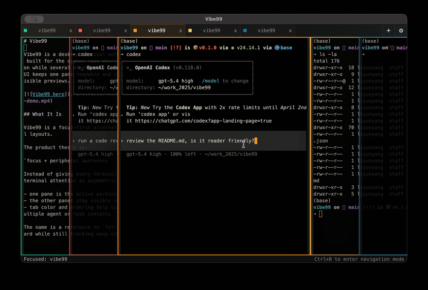

<p align="center"></p>
<p align="center"><strong>中文</strong> | <a href="README.md">English</a></p>

# Vibe99 — 多 Agent 终端工作台

一个人同时跑四五个 Coding Agent 已经是常态。但传统终端只有两种糟糕的选择：切标签页会把后台 Agent 彻底藏起来，跑完了也忘看；十字分屏又把每个窗口挤成豆腐块，哪一个都看不清。

所以我做了 **Vibe99**——一个按 **「一主聚焦、余光巡视」** 设计的 Agent 终端工作台。当前操作的终端永远保持全宽可读，其余终端层叠在侧，所有 Agent 的动静尽收眼底。

One developer now runs four or five coding agents at once. Traditional terminals give you two bad choices: tabs hide background agents until you forget they finished, while split grids shrink every pane until you cannot read any of them.

**Vibe99** is a desktop terminal workspace built for **one focused pane, peripheral vision on the rest**. You read and command one agent at full width, while the others stay stacked on screen so you can see every session move at a glance.



- **一主聚焦、余光巡视的层叠布局**：当前交互的终端保持大宽度清晰显示（默认 1210 px），后台终端层叠排布在视野边缘，随时看清每个 Agent 是在跑任务还是在等指令。
- **全键盘瞬时切换**：支持 `Ctrl+Tab` 按最近访问顺序切换、`Ctrl+Left` / `Ctrl+Right` 按空间位置平移、`Ctrl+Shift+O` 呼出命令面板模糊搜索标签页，或按 `Ctrl+B` 进入导航模式（`H`/`L` 移动、数字键 `1`–`9` 直达）。
- **高对比主题色与呼吸灯提醒**：内置 Okabe-Ito 高辨识度调色盘，靠颜色一眼区分不同窗口的 Agent；后台终端输出完毕静止后，可开启呼吸灯柔光提醒，切回即停。
- **专为真实终端痛点打磨**：SSH 断连后鼠标滚轮乱码可按 `Ctrl+Shift+M` 一键恢复且保留滚屏历史；精准对齐中日韩（CJK）双宽字符，跑 Claude Code 等 CLI 绝不发生输入漂移；后台异步探测 Windows WSL 发行版，绝不拖慢冷启动。
- **Tauri 2 + Rust 原生轻量体验**：告别臃肿的 Electron，基于 Tauri 2、`portable-pty` 与 WebGL 加速的 `xterm.js` 重构，原生安装包仅 ~5 MiB，重启自动恢复窗口布局、工作目录、Shell 配置与标签页标题。

## 快速开始

1. **直接下载安装包。** 前往 [GitHub Releases](https://github.com/NekoApocalypse/Vibe99/releases) 下载 Windows（`.msi`、`-setup.exe`）或 Linux（`.deb`、`.AppImage`、`.rpm`）安装包。

2. **从源码构建（推荐交给你的 Agent）。** 把本仓库地址丢给你常用的 Coding Agent（Claude Code、Codex、Antigravity、OpenCode 等），让它直接构建并启动 Vibe99。

3. **手动构建。** 环境要求：Node.js 22+ · Rust stable 工具链。

   ```bash
   npm ci
   npm run tauri:dev
   ```

   打包当前平台的原生安装包：

   ```bash
   npm run tauri:build
   ```

## 常用快捷键

| 快捷键 | 功能 |
|---|---|
| `Ctrl+N`（macOS 为 `Cmd+N`） | 新建终端面板 |
| `Ctrl+Tab` / `Ctrl+Shift+Tab` | 按最近访问记录在面板间切换 |
| `Ctrl+Left` / `Ctrl+Right` | 向左 / 向右切换到相邻面板 |
| `Ctrl+Shift+O`（`Cmd+Shift+O`） | 打开命令面板，模糊搜索标题并跳转 |
| `Ctrl+B` | 进入导航模式（`H`/`L` 或方向键移动，`1`–`9` 直达，`N` 新建，`R` 重命名，`X` 关闭，`Enter` 聚焦） |
| `Ctrl+Shift+C` / `Ctrl+Shift+V` | 在当前终端内复制 / 粘贴 |
| `Ctrl+Shift+M` | SSH 或 TUI 异常中断后一键恢复鼠标输入状态 |

双击标签页可重命名，拖拽标签页可调整顺序，右键标签页或终端可切换 Shell Profile、专属颜色与后台活动提醒。所有快捷键均可在右上角 **设置 → Keyboard Shortcuts** 中自定义。

## 当前局限

- **平台安装包**：目前提供 **Windows (x64)** 与 **Linux (x86_64)** 预编译安装包。**macOS** 预编译包在 Apple 签名与公证成本划算前暂停发布，macOS 用户可直接从源码构建运行（`npm run tauri:build`）。
- **Windows 代码签名**：正在接入 SignPath Foundation 开源签名（详见 [Code Signing Policy](CODE_SIGNING.md)）。`v0.7.3` 及更早版本的 Windows 安装包尚未签名，首次运行可能触发系统 SmartScreen 提示。
- **不做的功能**：内置代码编辑器、文件树、Git 图形界面或远端常驻守护进程。Vibe99 专注于让你高效并行操控多个终端 Agent——如果你需要极速审阅和编辑 Agent 产出的文档与代码，推荐配合 [Owlet](https://github.com/NekoApocalypse/owlet) 一起使用。

[版本下载 (Releases)](https://github.com/NekoApocalypse/Vibe99/releases) · [更新日志 (Changelog)](CHANGELOG.md) · [贡献指南 (Contributing)](CONTRIBUTING.md) · [代码签名策略 (Code Signing Policy)](CODE_SIGNING.md)

[GPL-3.0-or-later License](LICENSE) · [GitHub](https://github.com/NekoApocalypse/Vibe99)
