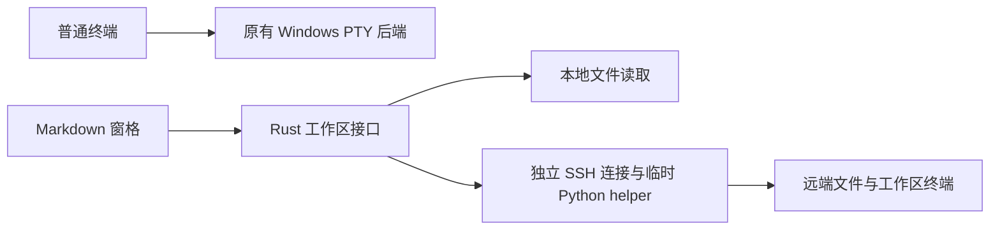

# Vibe99 Review 5：Markdown、独立 SSH 工作区与输入恢复

这份 Windows review 给终端用户增加只读 Markdown 窗格和可选的集成终端，并修复链接打开、鼠标恢复和 SSH 快速输入积压问题。SSH 工作区使用独立连接；关闭窗格或失联约 60 秒会结束它拥有的终端任务，重连不续接旧会话。**完整的“睡眠后 tmux/agy 滚轮同时翻历史”仍未复现，不能宣称已全面修好。**

## 可以验收什么

| 入口 | 本次行为与边界 |
| --- | --- |
| 顶栏 **MD** / 命令面板 | 打开本地或 SSH Markdown，支持代码高亮、公式、Mermaid 和文件图片；应用可见时每两秒检查文件变化，内容不变不重建文档。 |
| **Terminal** / 远端 `v99 file.md` | 同窗格显示 shell，远端命令可打开文档。隐藏终端会继续运行，关闭或重连会清理。文件接口只读，shell 仍有普通用户的执行/写入权限；Folder 用于解析路径，不是文件访问沙箱。 |
| 终端链接 / Markdown 链接 | 普通 URL 与终端程序输出的可点击文字链接（OSC 8）统一走 HTTP(S) 校验和系统浏览器，避开原先未经授权的 confirm 调用。终端保留原来的修饰键点击操作。 |
| **Ctrl+Shift+M** / 标签右键 | 只在手动恢复后的备用屏幕（全屏终端程序使用的屏幕）状态抑制滚轮转方向键；恢复鼠标跟踪或离开备用屏幕后解除。带当前会话标识的本地 PowerShell 提示符可退出残留备用屏幕，正常提示符不再恢复旧光标。可录制、停止并复制最多 64 条滚轮诊断，不记录普通输入或屏幕内容。 |

## 为什么这样接入

复用 Owlet 的渲染与远端协议思路，保留其 MIT 声明；没有引入 Electron/React 运行时。普通终端仍走原后端，预览及 Mermaid 按需加载，SSH 不进入启动路径。

远端输出在生产端最多积压 256 KiB / 64 包，前端解析后再确认，避免持续输出无限进入管道。SSH 输入改为有界字节队列，等待回复期间合并按键，每批最多 16 KiB，保持文本和鼠标字节顺序；前端队列（含发送中批次）最多 256 KiB，远端另有 64 KiB 上限。溢出或发送失败明确提示重连，不自动重放。连接关闭使用有限等待；远端每 15 秒收心跳，60 秒失联后对自有进程组先请求结束、再强制终止，并移除临时目录。

## 已验证的证据

- `npm test`：13 项通过；`remote/test_bridge.py`：9 项通过；Rust release 单元测试：30 项通过。浏览器层的预览、恢复、完整界面与原终端回归通过。
- `scripts/test-native-preview.cjs` 在最终 exe 上通过：真实 Tauri 文件读/图片/限制校验、中文与空格路径、公式/图表、真实 PowerShell 和重连/关闭清理。原生终端回归也验证启动不探测 WSL、可选探测不阻塞界面、输出限流及尾部排空。
- `remote/test_ssh_bridge.py` 在作者授权的 Linux 主机上通过：不确认输出时停在 64 包，文件查询仍响应；恢复后完整收到超过 1 MiB 输出；正常关闭及约 60 秒无心跳均清理自有 shell 和目录。
- `scripts/test-native-ssh-preview.cjs` 在最终 exe 上通过完整 SSH 界面链路、`v99` 打开文档和关闭清理。同一条 176 字符逐键输入加回车，修复前 30 秒仍未完成，最终验证约 1.2 秒完成。辅助 SSH 检查曾发生超时；最终完整一轮通过，这不是跨网络性能保证。

验证日志位于 `artifacts/review5-*.log`，最终 exe 为 `artifacts/Vibe99-Review-5/Vibe99-Review-5.exe`，SHA256：`857fe0d8980fc76b467d8c9b04c505424d7e2a1bc2c0546d3ef918d3caafe9f0`。

## 尚有明确限制

SSH 需要已配置的非交互认证与 known_hosts，远端需要 Linux、Python 3、Bash；不支持密码/MFA 提示，不自动接管已有 SSH/tmux。主动脱离会话的任务不保证清理。重启只记住窗格类型，文件和 SSH 要重新打开。文本限 UTF-8 / 4 MiB，图片限 16 MiB，不加载网络图片或原始 HTML。复杂大文档仍可能有渲染成本；本次没有宣称解决所有 UI 卡顿。依赖审计中原有的 4 项工具链高危告警仍在，新预览依赖没有新增已知告警。

Review 使用独立标识 `com.vibe99.review5`，复制了已安装版的 UI 偏好；未替换已安装应用，未推送或发布。代码、测试、使用说明、许可声明和 Towncrier 片段一并在本地分支 `codex/markdown-workspace-review` 待验收。操作说明见 [Markdown workspaces](../preview-workspaces.md)，未完全复现的滚轮问题见 [需求与证据](../requirements/terminal-wheel-recovery.md)。

建议亲测：打开自己的 Markdown → 用自己的 SSH 目录执行 `v99` → 在真实 tmux/agy 工作流复查滚轮，异常时录制诊断。

---

## Subagent Review Sign-Off

- **Review Harness**: Codex isolated subagent (`fork_turns=none`)
- **Model**: inherited session model
- **Verdict**: TRUST & EASILY READABLE
- **Scores**: TRUST: 9.5/10 | EASILY READABLE: 9/10
